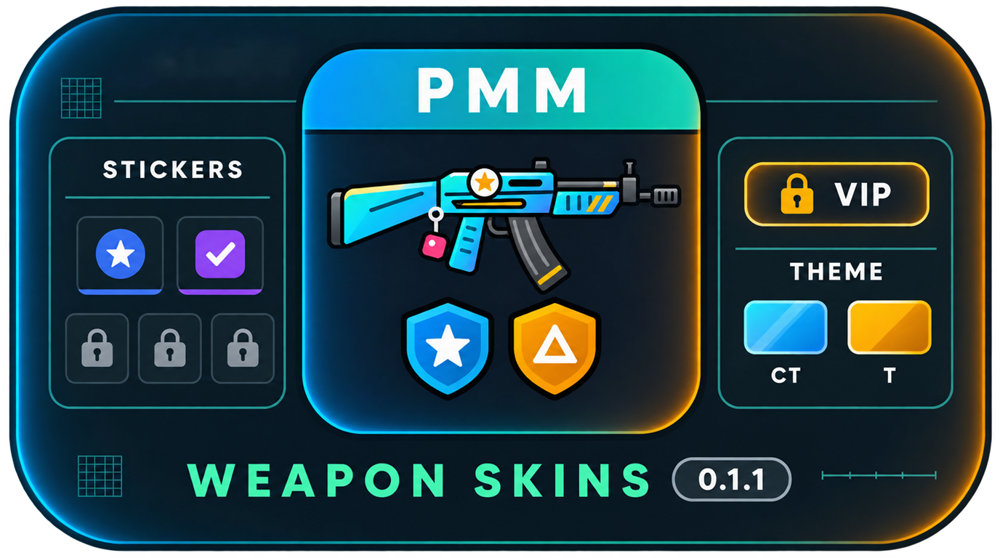

# PMM_WeaponSkins



<h2><a href="https://genesis-cs.space/menuconstructor/index.html">>>>Более подробная информация на сайте<<<</a></h2>

Panorama inventory menu for **WeaponSkins by Star** on CS2, by **Rimmer**, in the style of [PanoramaMenuManager](https://github.com/RRimmer/PanoramaMenuManagerCS2) plugins.

Current version: **0.1.1**.

## Requirements — must be installed

- **WeaponSkins core — [Staaar0/WeaponSkins](https://github.com/Staaar0/WeaponSkins) 1.2.2 or newer.** Mandatory: the author's build with `WeaponSkinsApi` (the PMM changes).
- **Panorama menu core — [RRimmer/PanoramaMenuManagerCS2](https://github.com/RRimmer/PanoramaMenuManagerCS2) 1.3.01.**
- CounterStrikeSharp **1.0.376+** (.NET 10).
- Panorama addon: copy `Content-addonmanager/panorama` and rebuild it in Workshop Tools, **or** use the ready Steam Workshop addon — for those who just want to add it to MultiAddonManager: [steamcommunity.com/sharedfiles/filedetails/?id=3823363089](https://steamcommunity.com/sharedfiles/filedetails/?id=3823363089)

## Features

- One screen: agent, gloves, knife, Zeus, music kit, pin and all weapons by category. Click the second agent to switch team.
- Skin settings: team (CT / T / both), wear with FN–BS presets, pattern, StatTrak, name tag.
- Stickers, up to 5 per weapon (the CS2 limit): slot spots, the allowed surface and the preview mapping come from the CS2 weapon models, so the sticker on the preview lands where it lands in the game. Position (game units, step 0.01, or click on the weapon), rotation, scrape. The fifth sticker starts on the model's fifth spot, or on slot 1's spot where there is none (AK-47, AWP, M4A4...), and can be moved from there.
- Sticker picker: sections (regular stickers, all, every tournament, newest first), sorting (newest / oldest / rarity / name A–Z, Z–A), rarity filter, search.
- Charm: attachment points from the models (KeychainMarkup), it can only hang on the weapon; pattern.
- Text input: on-screen keyboard (RU / EN) and / or chat. Lists: mouse wheel or pages.
- The WeaponSkins commands (`!ws`, `!skins`, `!knife`, `!gloves`, `!agents`, `!music`, `!pin`, `!stickers`) open this menu. `!g`, `!wear`, `!seed`, `!tag`, `!st` and the Discord bot work as before.
- Menu scale for 4:3, 5:4 and 16:10 screens: "Scale − +" in the top bar or `!wsscale 75`, remembered per player.
- Languages `ru`, `en`, `tr`.

## Repository layout

| Folder | What it is |
| --- | --- |
| `PMM_WeaponSkins` | The plugin: `Plugin.cs` (life cycle, HUD entity), `Plugin.Nav.cs` (lists, saving, picker), `Plugin.View.cs` (painting), `Plugin.Click.cs` (buttons), `Plugin.Input.cs` (keyboard / chat), `Bridge.cs` (WeaponSkinsApi by reflection), `StickerGeo.cs` (sticker and charm geometry), `Model.cs`, `State.cs`, `Lang.cs` |
| `PMM_WeaponSkins/lang` | Translations `ru.json`, `en.json`, `tr.json` (key: text); copied to `plugins/PMM_WeaponSkins/lang/` |
| `PMM_WeaponSkins/panorama` | Client files for the MultiAddonManager addon: `pmm_ws.xml`, `pmm_ws.css`, `pmm_ws_art.css`, `pmm_ws_stickers.css`, PNG placeholders |
| `tools` | `gen_layout.py` (layout, stylesheet, `Layout.g.cs`), `gen_art.py` (pictures, rarity), `gen_stickergeo.py` (sticker geometry from the models), model readers |
| `configs` | Example config with a comment on every key |
| `images` / `icon` | README banner and the plugin icon |

## Install from a Release

1. Copy `Server-plugins/counterstrikesharp` into `game/csgo/addons/`.
2. Copy `Content-addonmanager/panorama` into the MultiAddonManager addon and rebuild it in Workshop Tools.
3. In the WeaponSkins config set `"Menu_Style": 3` (RRimmer-PanoramaMenu). With 1 or 2 WeaponSkins opens its own menu and this panorama stays closed.
4. Restart the server.

## Config (`PMM_WeaponSkins.json`)

| Key | Default | What it does |
| --- | --- | --- |
| `Language` | `ru` | `ru`, `en`, `tr` or your own code with a `lang/<code>.json` file (item names come from WeaponSkins, `api.language`) |
| `ListMode` | `scroll` | `scroll` mouse wheel, `pages` pages 1, 2, 3 |
| `InputMode` | `both` | `both` keyboard and "write in chat", `keyboard`, `chat` |
| `Commands` | `[]` | extra commands that open the menu, e.g. `["inv"]` |
| `OpenDelay` / `InputDelay` | `0.1` / `0.15` | delay before the menu and the mouse cursor |
| `ChatTimeout` | `30` | seconds to wait for a chat answer |
| `Debug` | `false` | verbose `[PMM-WS]` log |
| `UseWeaponSkinsDatabase` | `true` | player settings (scale, sorting) live in the WeaponSkins MySQL database, shared by every server on it. The `pmm_ws_players` table is created automatically |
| `Database` | empty `Host` | another MySQL database, when `UseWeaponSkinsDatabase` is `false` |
| `RepaintPickedUpDefault` | `false` | repaint only picked-up weapons **without a skin** (lying on the map); other players' skins stay |
| `RepaintPickedUp` | `false` | a picked-up weapon (from the ground or another player) gets the new holder's own skin, or none when they have no skin for it. Needs WeaponSkins with `ApplyToWeapon` |
| `Sections` | all `true` | which sections are shown: Agents, Gloves, Knife, Zeus, Music, Pins, Pistols, SMGs, Shotguns, Rifles, Snipers, MachineGuns |
| `Access` | all `[]` | who may open a section: `"vip"`, `"vip:GROUP"`, admin flag `"@css/generic"`, admin group `"#css/admin"`. A locked section stays visible with a padlock |
| `Features` | all `[]` | who may use StatTrak, name tags, stickers, charms, wear and pattern (rules as in `Access`). A locked setting stays visible, greyed with a padlock; the skin is saved with the default |
| `StickerSlots` | `{}` (5 for all) | sticker slots per rule: `{ "*": 1, "vip:VIPBronze": 2, "vip:VIPGold": 5 }` — the most of the matching rules |
| `Theme` | CT `sky`/`blue`, T `gold`/`amber`, `GlowSize` 2 | menu colour (`Color`) and outer glow (`Glow`) per team: one of 32 names (listed in the config) or `#rrggbb`, snapped to the nearest; `GlowSize` 0–3 |
| `HiddenWeapons` | `[]` | weapons, knives and gloves hidden inside their sections, e.g. `["weapon_negev", "weapon_knife_kukri", "sporty_gloves"]` (all names are listed in the config) |
| `Scale` | `100` | default menu scale, %: 100 / 90 / 80 / 75 / 70 / 60 (16:10: 90, 4:3: 75, 5:4: 70) |

## Build

```
dotnet build PMM_WeaponSkins.sln -c Release
```

The plugin talks to WeaponSkins through reflection, so WeaponSkins is not needed to build it.

---

# PMM_WeaponSkins


<h2><a href="https://genesis-cs.space/menuconstructor/index.html">>>>Более подробная информация на сайте<<<</a></h2>

Панорамное меню инвентаря для **WeaponSkins by Star** в CS2 от **Rimmer**, в стиле плагинов [PanoramaMenuManager](https://github.com/RRimmer/PanoramaMenuManagerCS2).

Текущая версия: **0.1.1**.

## Что нужно установить — обязательно

- **Ядро WeaponSkins — [Staaar0/WeaponSkins](https://github.com/Staaar0/WeaponSkins) версии 1.2.2 и выше.** Обязательно: версия автора с `WeaponSkinsApi` (изменения для PMM).
- **Ядро меню — [RRimmer/PanoramaMenuManagerCS2](https://github.com/RRimmer/PanoramaMenuManagerCS2) 1.3.01.**
- CounterStrikeSharp **1.0.376+** (.NET 10).
- Аддон панорамы: скопируйте `Content-addonmanager/panorama` и пересоберите его в Workshop Tools, **или** возьмите готовый аддон из мастерской Steam — для тех, кто хочет просто прописать его в MultiAddonManager: [steamcommunity.com/sharedfiles/filedetails/?id=3823363089](https://steamcommunity.com/sharedfiles/filedetails/?id=3823363089)

## Возможности

- Один экран: агент, перчатки, нож, Zeus, музыка, медаль и всё оружие по категориям. Смена стороны — клик по второму агенту.
- Настройка скина: сторона (КТ / Т / обе), износ с кнопками FN–BS, паттерн, StatTrak, именной тег.
- Наклейки, до 5 на оружие (предел CS2): места слотов, допустимая поверхность и привязка к картинке взяты из моделей оружия CS2, поэтому наклейка на превью стоит там же, где в игре. Положение (единицы игры, шаг 0,01, или клик по оружию), поворот, потёртость. Пятая наклейка встаёт на пятое место модели, а где его нет (AK-47, AWP, M4A4 и др.) — на место первого слота, дальше её можно передвинуть.
- Выбор наклеек: разделы (обычные, все, каждый турнир — новые сверху), сортировка (новые / старые / редкость / название А–Я, Я–А), фильтр по редкости, поиск.
- Брелок: места крепления из моделей (KeychainMarkup), вешается только на оружие; шаблон.
- Ввод текста: экранная клавиатура (RU / EN) и / или чат. Списки: колесо мыши или страницы.
- Команды WeaponSkins (`!ws`, `!skins`, `!knife`, `!gloves`, `!agents`, `!music`, `!pin`, `!stickers`) открывают это меню. `!g`, `!wear`, `!seed`, `!tag`, `!st` и Discord-бот работают как раньше.
- Масштаб меню для экранов 4:3, 5:4 и 16:10: «Масштаб − +» в шапке или `!wsscale 75`, запоминается за игроком.
- Языки `ru`, `en`, `tr`.

## Что где лежит

| Папка | Что это |
| --- | --- |
| `PMM_WeaponSkins` | Плагин: `Plugin.cs` (жизненный цикл, сущность HUD), `Plugin.Nav.cs` (списки, сохранение, выбор наклеек), `Plugin.View.cs` (отрисовка), `Plugin.Click.cs` (кнопки), `Plugin.Input.cs` (клавиатура / чат), `Bridge.cs` (WeaponSkinsApi через рефлексию), `StickerGeo.cs` (геометрия наклеек и брелков), `Model.cs`, `State.cs`, `Lang.cs` |
| `PMM_WeaponSkins/lang` | Переводы `ru.json`, `en.json`, `tr.json` (ключ: текст); кладутся в `plugins/PMM_WeaponSkins/lang/` |
| `PMM_WeaponSkins/panorama` | Клиентские файлы для аддона MultiAddonManager: `pmm_ws.xml`, `pmm_ws.css`, `pmm_ws_art.css`, `pmm_ws_stickers.css`, PNG-заглушки |
| `tools` | `gen_layout.py` (разметка, стили, `Layout.g.cs`), `gen_art.py` (картинки, редкость), `gen_stickergeo.py` (геометрия наклеек из моделей), чтение моделей |
| `configs` | Пример конфига с комментарием к каждому ключу |
| `images` / `icon` | Баннер README и иконка плагина |

## Установка из релиза

1. Скопируйте `Server-plugins/counterstrikesharp` в `game/csgo/addons/`.
2. Скопируйте `Content-addonmanager/panorama` в аддон MultiAddonManager и пересоберите его в Workshop Tools.
3. В конфиге WeaponSkins поставьте `"Menu_Style": 3` (RRimmer-PanoramaMenu). При 1 или 2 WeaponSkins открывает своё меню, а панорама не открывается.
4. Перезапустите сервер.

Подробнее — [INSTALL.md](INSTALL.md).

## Конфиг (`PMM_WeaponSkins.json`)

| Ключ | По умолчанию | Что делает |
| --- | --- | --- |
| `Language` | `ru` | `ru`, `en`, `tr` или свой код с файлом `lang/<код>.json` (названия предметов берутся из WeaponSkins, `api.language`) |
| `ListMode` | `scroll` | `scroll` — колесо мыши, `pages` — страницы 1, 2, 3 |
| `InputMode` | `both` | `both` — клавиатура и «Написать в чате», `keyboard`, `chat` |
| `Commands` | `[]` | дополнительные команды открытия, например `["inv"]` |
| `OpenDelay` / `InputDelay` | `0.1` / `0.15` | задержка показа меню и включения курсора |
| `ChatTimeout` | `30` | сколько секунд ждать ответ в чате |
| `Debug` | `false` | подробный лог `[PMM-WS]` |
| `UseWeaponSkinsDatabase` | `true` | настройки игроков (масштаб, сортировки) хранятся в MySQL WeaponSkins — общие для всех серверов на этой базе. Таблица `pmm_ws_players` создаётся сама |
| `Database` | `Host` пустой | своя база MySQL, если `UseWeaponSkinsDatabase` = `false` |
| `RepaintPickedUpDefault` | `false` | перекрашивать только подобранное оружие **без скина** (валялось на карте); чужие скины остаются |
| `RepaintPickedUp` | `false` | подобранное оружие (с земли или у другого игрока) перекрашивается в скин того, кто подобрал; без своего скина — без скина. Нужен WeaponSkins с `ApplyToWeapon` |
| `Sections` | всё `true` | какие разделы видны: Agents, Gloves, Knife, Zeus, Music, Pins, Pistols, SMGs, Shotguns, Rifles, Snipers, MachineGuns |
| `Access` | все `[]` | кто может открыть раздел: `"vip"`, `"vip:ГРУППА"`, флаг админа `"@css/generic"`, группа `"#css/admin"`. Закрытый раздел виден с замком |
| `Features` | все `[]` | кто может пользоваться StatTrak, именным тегом, наклейками, брелками, износом и паттерном (правила как в `Access`). Недоступное видно серым с замком, скин сохраняется со значением по умолчанию |
| `StickerSlots` | `{}` (всем 5) | число слотов наклеек по правилам: `{ "*": 1, "vip:VIPBronze": 2, "vip:VIPGold": 5 }` — берётся наибольшее из подходящих |
| `Theme` | КТ `sky`/`blue`, Т `gold`/`amber`, `GlowSize` 2 | цвет меню (`Color`) и свечения по краям (`Glow`) для каждой стороны: название из 32 цветов (список в конфиге) или `#rrggbb` — берётся ближайший; `GlowSize` 0–3 |
| `HiddenWeapons` | `[]` | какие оружия, ножи и перчатки скрыть внутри разделов, например `["weapon_negev", "weapon_knife_kukri", "sporty_gloves"]` (полный список имён — в конфиге) |
| `Scale` | `100` | масштаб меню по умолчанию, %: 100 / 90 / 80 / 75 / 70 / 60 (16:10 — 90, 4:3 — 75, 5:4 — 70) |

## Сборка

```
dotnet build PMM_WeaponSkins.sln -c Release
```

Плагин обращается к WeaponSkins через рефлексию, поэтому для сборки WeaponSkins не нужен.
